# Spotify Architecture & Spatch Flow Map

This document maps how Spotify for Android works internally and how Spatch intercepts, replaces, or extends each subsystem across the build pipeline and at runtime.

For binary hashes, DEX reference limits, and porting tools, see [Patch Targets & Reverse Engineering Notes](targets.md).

---

## 1. High-Level System Map

Spotify for Android is a hybrid app combining **classical Android Views** (the main shell, full player, mini-player, and RecyclerViews), **Jetpack Compose + Encore** (Spotify's design system powering Home, Search, Library, Drawer, and Lyrics), a **native C++ audio engine (`liborbit-jni.so`)**, and **Glance app widgets**.

Spatch modifies Spotify through four static layers at build time and one companion DEX (`classes16.dex`) at runtime:

```mermaid
flowchart TB
    subgraph Build["Build-Time Patch Pipeline (Rust)"]
        ARSC["resources.arsc\nIn-place 8-byte color swaps"]
        XML["20 Binary XML Diffs\nLayouts, Drawables, Scenes"]
        LOTTIE["res/raw/*.json\nLottie vector recoloring"]
        SMALI["102 Guarded Smali Edits\nAcross 11 DEX files + 13 relocated classes"]
        HELPER["classes16.dex\n59 spatch.* Helper Classes (+4 debug)"]
    end

    subgraph Runtime["Spotify Runtime Subsystems"]
        BOOT["Boot & Lifecycle\nSplitCompat → Settings.load\nActivity & Window Tree Hooks"]
        SHELL["App Shell & Navigation\nMainLayout + Floating NavBar\nPage Transitions & Predictive Back"]
        PLAYER["Full Player (NPV)\nPlayerArt + Atmosphere + Scallop\nWave Seekbar + Lyrics + Immersive"]
        MINI["Mini-Player (NowPlayingBar)\nMiniBar MotionLayout + MiniRing\nMiniSurface + MiniArt.Fling"]
        FEEDS["Feeds & Content Lists\nHome + Search + Your Library\nPlaylist Rows + Queue Sheet"]
        DRAWER["Drawer, Profile & Settings\nS_Drawer + ProfileBanner\nSpatchSettings Bottom Sheet"]
        AUDIO["Audio Engine\nliborbit-jni → AudioTrackAdapter\nAudioEffectsListener → Visualizer FFT"]
        ENCORE["Encore Design System\nPalette + Surfaces + Fonts\nCompose Shapes & Press Physics"]
        WIDGET["Home Screen Widget\nMediaSession + GlanceRemoteViews"]
    end

    ARSC --> ENCORE
    XML --> SHELL & PLAYER & MINI & WIDGET
    LOTTIE --> PLAYER & FEEDS
    SMALI --> BOOT & SHELL & PLAYER & MINI & FEEDS & DRAWER & AUDIO & ENCORE & WIDGET
    HELPER --> BOOT & SHELL & PLAYER & MINI & FEEDS & DRAWER & AUDIO & ENCORE & WIDGET
```

---

## 2. Boot, Initialization & Live Theme Flow

Spatch has no custom `Application` subclass of its own. Instead, it piggybacks on Spotify's earliest guaranteed entry point and then observes every `Activity` and window tree from there.

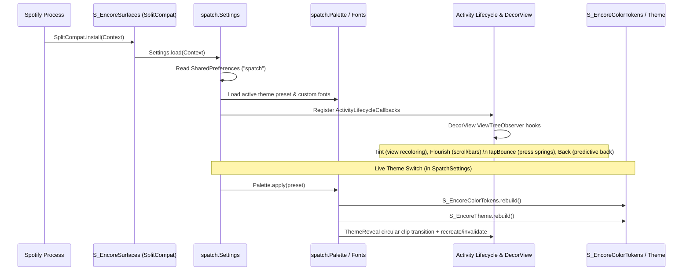

### Key Interception Points
| Stage | Spotify Target | Spatch Hook | Flow & Behavior |
| --- | --- | --- | --- |
| **Process Boot** | `S_EncoreSurfaces` | `Settings.load(Context)` | Runs immediately after `SplitCompat.install(context)`. Initializes `Settings.on[]` boolean flags, loads saved theme tokens into `Palette`, initializes `Fonts`, and registers global `ActivityLifecycleCallbacks`. |
| **Window Attachment** | Every `Activity` `DecorView` | `Tint`, `Flourish`, `TapBounce`, `Back` | Traverses active view trees to apply runtime tinting (`Tint`), attach scroll listeners that slide floating bars away (`Flourish`), add press rebound physics (`TapBounce`), and register Android predictive back gestures (`Back`). |
| **Live Theme Rebuild** | `S_EncoreColorTokens`, `S_EncoreTheme` | `.method public static rebuild()V` | Spotify normally builds its Compose color scheme once in `<clinit>`. Spatch removes `final` from the static fields and factors `<clinit>` into `rebuild()`, allowing `Palette` to rebuild Encore's entire Compose color table live without restarting the process. |

---

## 3. App Shell, Floating Navigation & Page Transitions

Spotify's portrait phone shell (`res/layout/vertical_main.xml`) stacks the page container, the mini-player (`now_playing_bar`), and the bottom navigation bar (`navigation_bar`) inside `com.spotify.mainlayout.ui.view.MainLayout`.

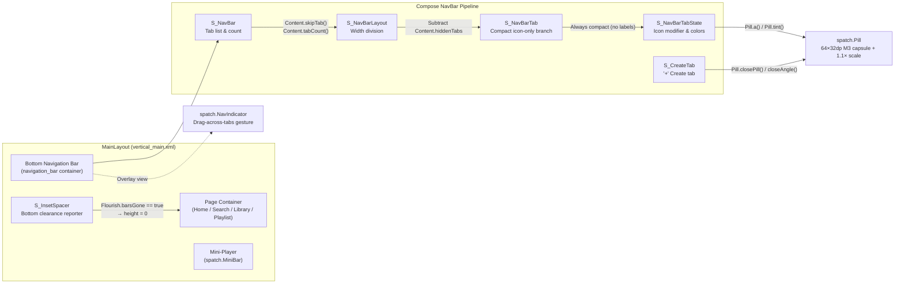

### How Each Shell Piece Works
1. **Floating Bar Geometry (`vertical_main.xml`):**
   - Stock Spotify docks a full-width opaque bottom bar. Spatch patches `vertical_main.xml` to give `navigation_bar` 16dp horizontal margins, 10dp bottom margin, and a 32dp corner radius.
2. **Scrolling Content Behind Floating Bars (`MainLayout` & `Flourish`):**
   - Spotify's `MainLayout` queries `S_InsetSpacer` (`f` and `g`) to pad the bottom of pages so lists stop above the bars.
   - When `Flourish` slides the floating bars off-screen during downward scroll (`Flourish.barsGone = true`), Spatch's edit in `MainLayout.smali` forces the measured spacer height to `0`, and permanently zeroes the touch-blocking strip (`g`) added in `9.2.0.26` so Your Library and playlists scroll cleanly underneath the floating pills.
3. **Tab Filtering & Reflow (`S_NavBar` + `S_NavBarLayout` → `Content`):**
   - `S_NavBar` calls `Content.skipTab(S_NavTab)` before opening a tab's Compose group (hiding the Premium upsell tab or Create tab when enabled in settings) and `Content.tabCount(List)` so remaining tabs divide the bar width evenly via `Content.hiddenTabs`.
4. **Icon-Only Tabs & Material 3 Pill (`S_NavBarTab` + `S_NavBarTabState` → `Pill`):**
   - `S_NavBarTab` normally hides text labels only on screens `< 520dp` tall. Spatch removes the height branch so tabs are always clean icons (while keeping TalkBack content descriptions intact).
   - `S_NavBarTabState` passes the icon's `Modifier` and colors through `Pill.a()`, `Pill.tint()`, and `Pill.labelTint()`, wrapping the active icon in an animated 64×32dp accent capsule with a 320ms overshooting spring.
   - `S_CreateTab` replaces Spotify's shrinking white disc with a tonal pill (`Pill.closePill`, `Pill.closeColor`) that rotates only the inner `+` glyph by 45° (`Pill.closeAngle`).
5. **Interactive Tab Scrubbing (`NavIndicator`):**
   - An overlay view matching `navigation_bar` bounds forwards normal taps to Compose, but once a horizontal drag exceeds touch slop, it tracks the finger with a live pill and dispatches synthetic `ACTION_DOWN`/`ACTION_UP` events to the target tab on release.
6. **Page Transitions (`S_PageTransition` + `res/anim/fade_in_hard.xml`):**
   - `S_PageTransition` queries `Settings.pageMotionEnabled()` so every page change uses smooth shared-axis/fade motion instead of hard cuts.

---

## 4. Full Player (Now Playing View) Flow

When the user expands the player (`NowPlayingActivity` → `revised_template_page_layout.xml` + `revised_template_overlay.xml`), Spatch coordinates artwork, audio FFT, backdrop rendering, transport physics, seekbar waveforms, lyrics, and full-screen immersive mode.

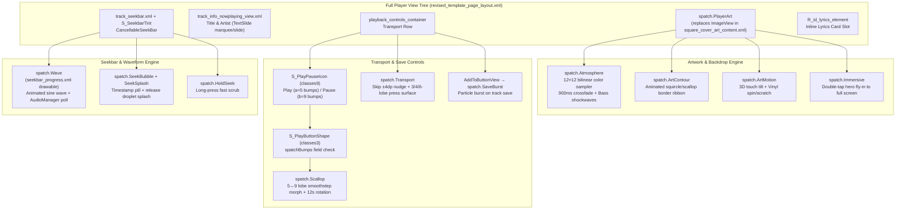

### Detailed Player Data & UI Flows

#### 4.1 Artwork, Vinyl Scratch & Ambient Backdrop (`PlayerArt`, `Atmosphere`, `ArtMotion`, `ArtContour`)
1. **Inflation:** `res/layout/square_cover_art_content.xml` swaps Spotify's stock `ImageView` for `spatch.PlayerArt`.
2. **Color Extraction (`Atmosphere`):** Whenever the cover drawable changes on the centered carousel page (`getLocationOnScreen` within screen width / 4, ignoring off-screen ViewPager pages), `Atmosphere` downsamples the bitmap to a 12×12 grid, extracts dominant/accent colors, and crossfades the player's full-screen background gradient over 900ms.
3. **Audio Reactivity:** `Atmosphere` and `PlayerArt` read live frequency bands from `AudioSpectrum.SHARED`. Low-frequency kicks emit radial bass shockwaves behind the cover; mid/high bands drive the 24-wave radial contour halo around the art.
4. **Touch Interactions (`ArtMotion`):**
   - **Single touch / hold:** Applies a 3D perspective tilt toward the finger and allows rotational vinyl scratching to scrub the track.
   - **Double tap:** Either triggers the "catchphrase pill" easter egg or launches the full-screen `Immersive` player with a hero bounds handoff (`PlayerArt.drawHeroImage`).

#### 4.2 Play/Pause Scallop Morphing (`S_PlayPauseIcon` → `S_PlayButtonShape` → `Scallop`)
1. **Why two classes are involved:** `S_PlayPauseIcon` lives in `classes9.dex` (which has **0 free method references**—exactly 65,536), while `S_PlayButtonShape` (the circular background `Drawable`) lives in `classes3.dex` (which has plenty of room).
2. **Field-Only Tagging in `classes9.dex`:** Spatch adds `.field public spatchBumps:I` to `S_PlayButtonShape`. In `S_PlayPauseIcon`'s constructor, Spatch writes `spatchBumps = 5` onto the Play drawable (`field a`, shown while paused) and `spatchBumps = 9` onto the Pause drawable (`field b`, shown while playing) using only field instructions (`iput`).
3. **Static Redirect in `classes3.dex`:** When `S_PlayButtonShape.draw(Canvas)` runs, if `spatchBumps > 0`, it calls `Scallop.draw(canvas, radius, paint, bumps, this)` instead of `canvas.drawCircle()`.
4. **Morph & Spin:** `Scallop` links the Play and Pause drawable instances via a `WeakHashMap` keyed by their shared `ImageButton` callback. Toggling playback smoothly interpolates between 5 lobes (paused) and 9 lobes (playing) over 440ms with a 3.5% spring settle, while rotating the 9-lobe contour at 1 turn per 12 seconds (keeping the inner play/pause glyph upright).

#### 4.3 Seekbar Waveform & Splash (`S_SeekbarTint`, `Wave`, `SeekBubble`, `SeekSplash`)
1. **Progress Drawable:** `res/drawable/seekbar_progress.xml` replaces the flat progress bar with `<clip><drawable class="spatch.Wave"/></clip>`, and `track_seekbar.xml` expands the container height to 12dp.
2. **Tint:** `S_SeekbarTint` swaps `R_color_default_seekbar_color` for `R_color_dark_base_essential_brightaccent` (mapped to the theme's primary accent).
3. **Playback Detection:** `Wave` advances phase only when playback is active. Because Spotify freezes seekbar progress updates while the user's finger is dragging the thumb, `Wave` supplements progress-delta detection with a throttled (500ms) `AudioManager.isMusicActive()` check so the wave keeps oscillating while scrubbing a playing track.
4. **Scrub Feedback:** Dragging displays `SeekBubble` above the thumb with haptic detent ticks (`Haptics`), and releasing triggers `SeekSplash` particle droplets across the bar.

#### 4.4 Inline & Immersive Lyrics (`PlayerLyrics`, `S_LyricLine`, `ImmersiveLyrics`)
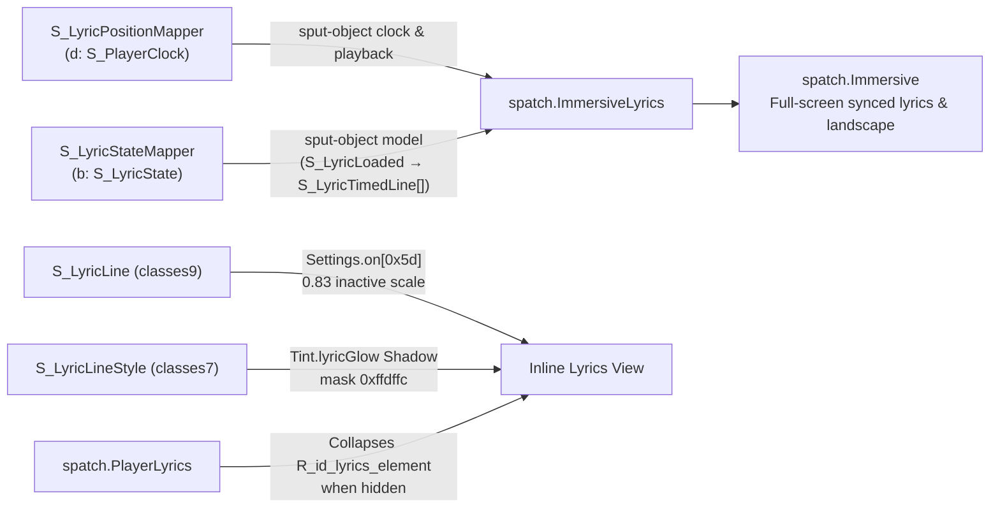
- **Zero-Method-Ref State Capture:** Because `S_LyricPositionMapper` and `S_LyricStateMapper` reside in `classes9.dex`, Spatch captures Spotify's native `S_PlayerClock`, playback state, and `S_LyricState` (`S_LyricLoaded` → `S_LyricData` → `S_LyricContent` → `S_LyricTimedLine` list) using `sput-object` writes directly into static fields on `spatch.ImmersiveLyrics`.
- **Orientation Control:** `SpotifyMainActivity.r(I)` is hooked so that when `Immersive.landscapeRequested` is true, Spotify's portrait lock is overridden with `SCREEN_ORIENTATION_FULL_USER` (`0xd`), restoring the page's saved orientation policy upon exiting immersive mode.

---

## 5. Mini-Player (`NowPlayingBar`) Flow

The mini-player (`res/layout/now_playing_bar.xml`) is a `MotionLayout` driven by `res/xml/now_playing_bar_scene.xml`.

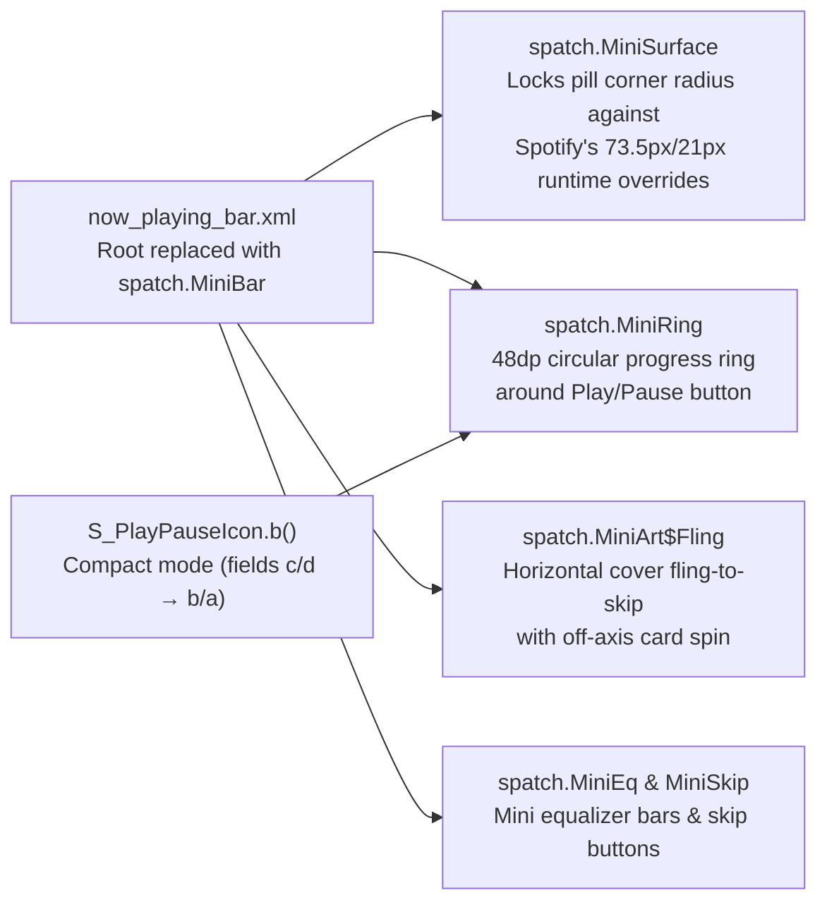

- **Why `MiniSurface` is needed:** Spotify's controller code dynamically calls `setCornerRadius(73.5f)` and `setCornerRadius(21f)` on the mini-player background as it animates. `MiniSurface` intercepts these mutations so the mini-player maintains a consistent floating pill radius matching the bottom navigation bar.
- **Scalloped Mini Play/Pause:** In stock Spotify, compact player modes (`S_PlayPauseIcon` fields `c` and `d`) render bare 24dp play/pause icons without a background shape. Spatch's smali edit redirects compact mode to read fields `b` and `a` (`S_PlayButtonShape`), bringing the morphing 5/9-lobe `Scallop` button into the mini-player surrounded by `MiniRing`.

---

## 6. Audio Engine & Real-Time Spectrum Flow

Spatch drives all audio visualizers (artwork contour ring, bass shockwaves, immersive spectrum, mini equalizer, and settings preview) directly from Spotify's internal audio session—**requiring zero microphone (`RECORD_AUDIO`) permissions**.

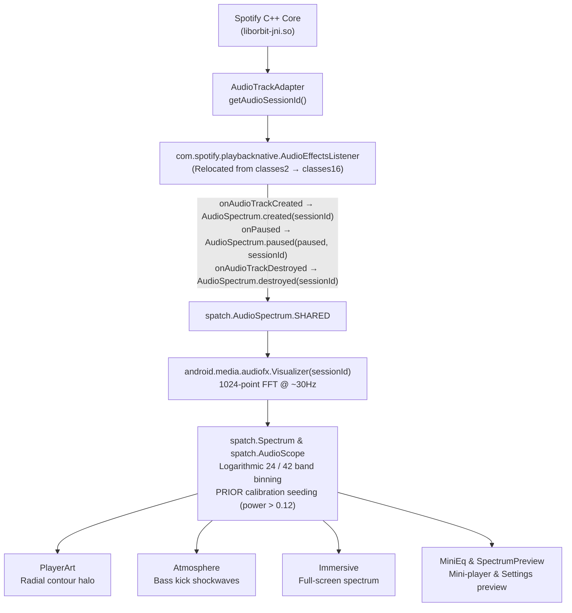

---

## 7. Content Feeds, Lists & Redaction Flow

Spatch intercepts data models before they reach Compose/RecyclerView adapters to strip unwanted upsells/content types and wrap items in Material 3 tonal surfaces.

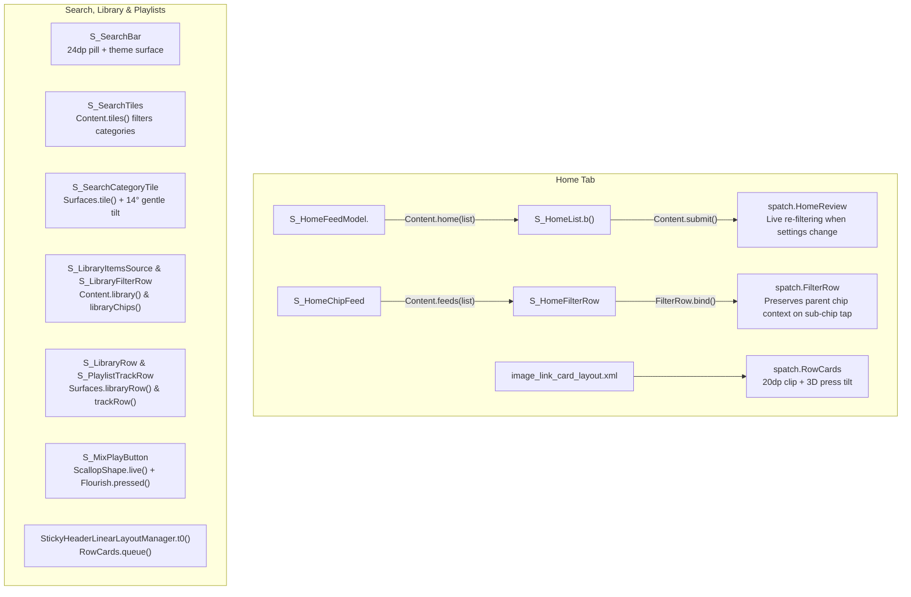

### Content Redaction Rules (`spatch.Content`)
| Surface | Hooked Class | Method | What It Filters / Modifies |
| --- | --- | --- | --- |
| **Home Sections** | `S_HomeFeedModel` (`rnc0`) | `Content.home(List)` | Strips podcast, audiobook, and promotional shelf sections (`spotify:section:*`, podcast/audiobook page URIs) based on user toggles; caches the `S_HomeList` instance via `Content.submit()` so `HomeReview` can re-submit a filtered model immediately when settings change. |
| **Home Filter Chips** | `S_HomeChipFeed` (`dqu`) | `Content.feeds(List)` | Removes "Podcasts" and "Audiobooks" top filter chips on Home. |
| **Home Sub-Chip Selection** | `S_HomeFilterRow` (`az50`) | `FilterRow.bind(...)` | Fixes Spotify's default reducer where tapping a parent chip while a child chip is active resets all the way to "All". |
| **Search Browse Tiles** | `S_SearchTiles` (`m9e`) | `Content.tiles(ArrayList)` | Filters hidden category tiles before grid layout so remaining tiles reflow without gaps. |
| **Your Library Items & Chips** | `S_LibraryItemsSource` (`u1p1`), `S_LibraryFilterRow` (`c0p1`) | `Content.library()`, `Content.libraryChips()` | Filters hidden media types from both the Library list and the top filter chip bar. |
| **Bottom Nav Tabs** | `S_NavBar` (`stn0`) | `Content.skipTab()`, `Content.tabCount()` | Skips the free-tier "Premium" tab and/or "Create" tab and recalculates tab count for layout division. |

---

## 8. Side Drawer, Profile & Spatch Settings Flow

Spatch embeds its own settings UI directly into Spotify's side drawer without adding a separate launcher icon.

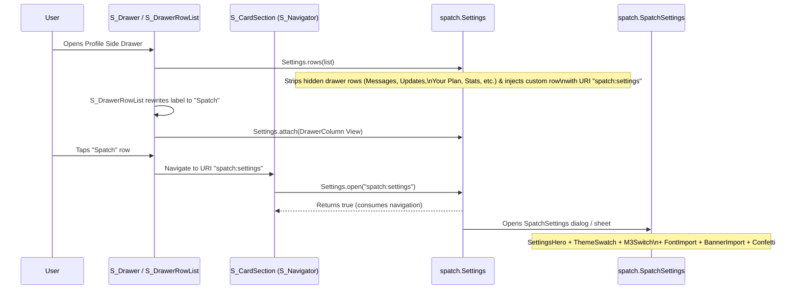

- **Drawer Customization (`S_Drawer`, `S_ProfileCard`, `S_AccountCardContent`):**
  - `S_Drawer` passes its row list through `Settings.rows(List)`, which removes unwanted entries (e.g. `S_YourPlanRowProvider`, `S_ListeningStatsRowProvider`, `S_TasteProfileRowProvider`, `S_MessagesRowProvider`) and inserts a clone of a drawer row pointing to `"spatch:settings"`.
  - `S_DrawerRowList` intercepts the string resource lookup for `R_string_mixing_edit_page_customize_button` and replaces the display text with `"Spatch"`.
  - `S_ProfileCard` reads `Settings.on[0x61]` to optionally disable the account-switcher chevron/expansion, and `S_AccountCardContent` reads `Settings.on[0x62]` to hide the "Parental controls" row.
- **Own Profile Banner (`S_OwnProfileTopBar` → `ProfileBanner`):**
  - Detects when the viewed profile belongs to the logged-in user (via `S_ProfileEditAction`) and replaces Spotify's flat header color with a custom image/shader brush (`ProfileBanner.brush`, imported via `BannerImport`) and matching top bar color (`ProfileBanner.bar`).

---

## 9. Encore Design System, Theme & Typography Flow

Because Spotify renders screens through both Android Views and Jetpack Compose, Spatch's theme engine coordinates four color channels, three shape hooks, and five font loaders simultaneously:

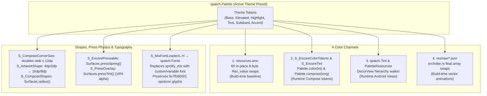

---

## 10. Home Screen Widget (`Glance` & `MediaSession`) Flow

Spotify builds its Now Playing home-screen widget using Jetpack Glance (`S_GlanceRemoteViews`), which translates a Compose tree into `RemoteViews` on the main thread on every state update.

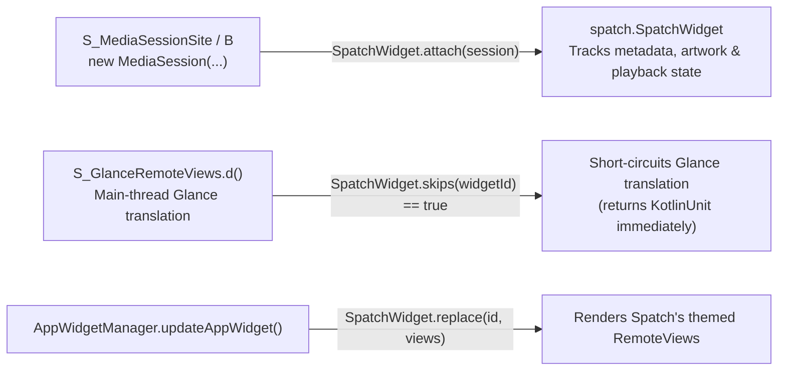

---

## 11. Complete `spatch.*` Helper Directory (`classes16.dex`)

All 59 runtime helper classes (plus 4 `--debug` classes) live under `theme/dex/src/spatch/` and compile into `classes16.dex`:

### `spatch/player/` — Full Player, Artwork, Transport, Seekbar & Lyrics
| Helper Class | Hooked Entry / Caller | Responsibility |
| --- | --- | --- |
| [`PlayerArt`](../theme/dex/src/spatch/player/PlayerArt.java) | `res/layout/square_cover_art_content.xml` | Custom cover art view: squircle/circle clip, radial audio contour, double-tap detector, hero handoff to `Immersive`. |
| [`Atmosphere`](../theme/dex/src/spatch/player/Atmosphere.java) | `PlayerArt` | 12×12 bilinear artwork color sampler, 900ms smoothstep backdrop gradient crossfade, and bass FFT shockwaves. |
| [`ArtContour`](../theme/dex/src/spatch/player/ArtContour.java) | `PlayerArt` | Animated contour ribbon outline around the player cover art. |
| [`ArtMotion`](../theme/dex/src/spatch/player/ArtMotion.java) | `PlayerArt` | 3D touch perspective tilt and vinyl record spin/scratch scrubbing. |
| [`Scallop`](../theme/dex/src/spatch/player/Scallop.java) | `S_PlayButtonShape.draw()` | Morphs Play/Pause button background between 5 lobes (paused) and 9 rotating lobes (playing). |
| [`ScallopShape`](../theme/dex/src/spatch/player/ScallopShape.java) | `S_MixPlayButton` | Compose `Shape` wrapper bringing the live scalloped outline to playlist header play buttons. |
| [`ScallopFill`](../theme/dex/src/spatch/player/ScallopFill.java) | `res/drawable/play_button_header_style_background.xml` | Custom XML `Drawable` rendering scalloped backgrounds in album/show headers. |
| [`Transport`](../theme/dex/src/spatch/player/Transport.java) | `PlayerArt` / NPV tree | Wraps shuffle, repeat, previous, and next buttons with 3/4/6-lobe press surfaces and ±4dp directional skip nudges. |
| [`Wave`](../theme/dex/src/spatch/player/Wave.java) | `res/drawable/seekbar_progress.xml` | Custom seekbar progress drawable rendering an animated sine wave while playing and flat line while paused/dragging. |
| [`SeekBubble`](../theme/dex/src/spatch/player/SeekBubble.java) | Seekbar touch hook | Floating timestamp pill above the seekbar thumb during scrubbing. |
| [`SeekSplash`](../theme/dex/src/spatch/player/SeekSplash.java) | Seekbar release / vinyl commit | Emits particle droplet physics across the seekbar when a seek is committed. |
| [`HoldSeek`](../theme/dex/src/spatch/player/HoldSeek.java) | Player gesture hook | Press-and-hold fast-forward / rewind scrubbing gesture. |
| [`SaveBurst`](../theme/dex/src/spatch/player/SaveBurst.java) | `AddToButtonView.a(S_SaveButtonState)` | Celebratory particle burst when saving/liking a track. |
| [`TextSlide`](../theme/dex/src/spatch/player/TextSlide.java) | Now Playing track info | Directional slide and crossfade animation when track title or artist text changes. |
| [`PlayerLyrics`](../theme/dex/src/spatch/player/PlayerLyrics.java) | NPV view tree (`R_id_lyrics_element`) | Collapses or restores the bottom inline lyrics preview card slot cleanly without breaking Spotify's state updates. |
| [`Immersive`](../theme/dex/src/spatch/player/Immersive.java) | `PlayerArt` double-tap, `SpotifyMainActivity.r(I)` | Full-screen portrait & landscape player overlay with hero fly-in, Spoticon transport controls, and touch replay. |
| [`ImmersiveButton`](../theme/dex/src/spatch/player/ImmersiveButton.java) | NPV header / toolbar | Entry button and chrome toggle for launching `Immersive` mode. |
| [`ImmersiveLyrics`](../theme/dex/src/spatch/player/ImmersiveLyrics.java) | `S_LyricPositionMapper`, `S_LyricStateMapper` | Receives native `S_PlayerClock` and `S_LyricState` via static fields to render time-synced lyrics inside `Immersive`. |
| [`Expansion`](../theme/dex/src/spatch/player/Expansion.java) | Player sheet transition | Coordinates smooth morphing between the mini-player bar and the full Now Playing view. |
| [`SpatchWidget`](../theme/dex/src/spatch/player/SpatchWidget.java) | `S_GlanceRemoteViews`, `S_MediaSessionSite` | Replaces Spotify's Glance Now Playing app widget with a themed `RemoteViews` widget fed by `MediaSession`. |

### `spatch/mini/` — Mini-Player (`NowPlayingBar`)
| Helper Class | Hooked Entry / Caller | Responsibility |
| --- | --- | --- |
| [`MiniBar`](../theme/dex/src/spatch/mini/MiniBar.java) | `res/layout/now_playing_bar.xml` | `MotionLayout` subclass hosting the floating mini-player pill and coordinating child hooks. |
| [`MiniSurface`](../theme/dex/src/spatch/mini/MiniSurface.java) | `MiniBar` | Locks the mini-player's corner radius and tonal border against Spotify's runtime corner overrides. |
| [`MiniRing`](../theme/dex/src/spatch/mini/MiniRing.java) | `MiniBar` | Wraps the mini-player play/pause button in a 48dp circular track progress indicator. |
| [`MiniArt`](../theme/dex/src/spatch/mini/MiniArt.java) | `MiniBar` | Handles cover rounding and `MiniArt.Fling` horizontal fling-to-skip gestures on the mini-player artwork. |
| [`MiniEq`](../theme/dex/src/spatch/mini/MiniEq.java) | `MiniBar` | Renders reactive mini equalizer bars inside the mini-player driven by `AudioSpectrum`. |
| [`MiniSkip`](../theme/dex/src/spatch/mini/MiniSkip.java) | `MiniBar` | Optional previous/next skip controls integrated into the mini-player layout. |

### `spatch/audio/` — Native FFT & Spectrum Analysis
| Helper Class | Hooked Entry / Caller | Responsibility |
| --- | --- | --- |
| [`AudioSpectrum`](../theme/dex/src/spatch/audio/AudioSpectrum.java) | `AudioEffectsListener` | Attaches `android.media.audiofx.Visualizer` to Spotify's internal `audioSessionId` and polls 1024-pt FFT at ~30Hz. |
| [`Spectrum`](../theme/dex/src/spatch/audio/Spectrum.java) | `AudioSpectrum` | Bins raw FFT magnitudes into 24/42 logarithmic bands with `PRIOR` calibration seeding and temporal smoothing. |
| [`AudioScope`](../theme/dex/src/spatch/audio/AudioScope.java) | `PlayerArt`, `Immersive` | Waveform and oscilloscope ring path generator from live audio frames. |
| [`SpectrumPreview`](../theme/dex/src/spatch/audio/SpectrumPreview.java) | `SpatchSettings` | Live interactive visualizer preview inside the Spatch Settings sheet. |

### `spatch/lists/` — Feeds, Navigation, Cards & Content Filtering
| Helper Class | Hooked Entry / Caller | Responsibility |
| --- | --- | --- |
| [`Content`](../theme/dex/src/spatch/lists/Content.java) | `S_HomeFeedModel`, `S_NavBar`, `S_SearchTiles`, `S_LibraryItemsSource` | Central content redaction engine for Home sections/chips, Search tiles, Library items/chips, and bottom NavBar tabs. |
| [`HomeReview`](../theme/dex/src/spatch/lists/HomeReview.java) | `Content`, `SpatchSettings` | Allows reviewing hidden Home sections and immediately re-submitting `S_HomeFeedModel` to `S_HomeList`. |
| [`FilterRow`](../theme/dex/src/spatch/lists/FilterRow.java) | `S_HomeFilterRow` | Preserves parent filter chip context when toggling sub-filter chips on Home. |
| [`Surfaces`](../theme/dex/src/spatch/lists/Surfaces.java) | `S_LibraryRow`, `S_PlaylistTrackRow`, `S_ToggleChip`, `S_PageBackground`, `S_DrawerLinkRows` | Wraps Compose rows, chips, headers, search tiles, and drawer items in tonal Material 3 card modifiers and springs. |
| [`RowCards`](../theme/dex/src/spatch/lists/RowCards.java) | `StickyHeaderLinearLayoutManager`, `image_link_card_layout.xml` | Applies rounded card clipping and 3D press tilt to View-based shelf cards and the Queue bottom sheet. |
| [`Flourish`](../theme/dex/src/spatch/lists/Flourish.java) | `MainLayout`, `S_MixPlayButton`, scroll hooks | Hides/shows floating bottom bars on scroll (`barsGone`) and triggers header play-button press bursts. |
| [`NavIndicator`](../theme/dex/src/spatch/lists/NavIndicator.java) | `navigation_bar` | Interactive horizontal drag-to-switch pill overlay on the bottom navigation bar. |
| [`ProfileBanner`](../theme/dex/src/spatch/lists/ProfileBanner.java) | `S_OwnProfileTopBar` | Custom `ShaderBrush` and top-bar tint for the user's own profile header. |

### `spatch/look/` — Theme Palette, Recoloring & Typography
| Helper Class | Hooked Entry / Caller | Responsibility |
| --- | --- | --- |
| [`Palette`](../theme/dex/src/spatch/look/Palette.java) | `S_EncoreColorTokens`, `S_EncoreTint`, `Settings` | Stores active theme color tokens, maps Encore ARGB/Compose colors, and triggers live `rebuild()` calls. |
| [`PaletteResources`](../theme/dex/src/spatch/look/PaletteResources.java) | `Tint`, `Settings` | Intercepts Android `Resources` color lookups at runtime to reflect live theme switches without APK rebuilds. |
| [`Tint`](../theme/dex/src/spatch/look/Tint.java) | Activity window trees, `S_LyricLineStyle` | Walks View hierarchies to recolor backgrounds/icons and provides `Tint.lyricGlow` shadow for active lyrics. |
| [`Fonts`](../theme/dex/src/spatch/look/Fonts.java) | `S_MixFontLoaderA..G` | Redirects Spotify Mix font resource IDs and Compose font weights to custom or bundled typefaces while sparing `spoticon`. |
| [`FontFile`](../theme/dex/src/spatch/look/FontFile.java) | `Fonts` | Validates and loads custom TTF/OTF typeface files from disk. |
| [`FontImport`](../theme/dex/src/spatch/look/FontImport.java) | `SpatchSettings` | Activity result document picker flow for importing user font files. |
| [`Typography`](../theme/dex/src/spatch/look/Typography.java) | `Fonts`, `Tint` | Applies font scale, weight, and letter-spacing adjustments across text views. |

### `spatch/motion/` — Springs, Haptics & Gestures
| Helper Class | Hooked Entry / Caller | Responsibility |
| --- | --- | --- |
| [`Pill`](../theme/dex/src/spatch/motion/Pill.java) | `S_NavBarTabState`, `S_CreateTab` | Material 3 overshooting selection capsule and `+` rotation animation for the bottom navigation bar. |
| [`TapBounce`](../theme/dex/src/spatch/motion/TapBounce.java) | Window tree touch hook | Samples pressed state across native buttons, compressing to 90% and rebounding on a 500ms damped spring. |
| [`Springy`](../theme/dex/src/spatch/motion/Springy.java) | Shared motion helper | Analytical damped harmonic oscillator and cubic-bezier evaluators used across player and UI animations. |
| [`Back`](../theme/dex/src/spatch/motion/Back.java) | Activity window hook | Predictive back gesture scale/translation preview on Android 13+. |
| [`Haptics`](../theme/dex/src/spatch/motion/Haptics.java) | Seekbar, buttons, switches | Tactile `VibrationEffect` primitives (detent ticks, clicks, heavy thuds) respecting system haptics settings. |
| [`ClickHaptic`](../theme/dex/src/spatch/motion/ClickHaptic.java) | View touch/click hooks | Attaches subtle haptic feedback to interactive controls. |
| [`Confetti`](../theme/dex/src/spatch/motion/Confetti.java) | `SpatchSettings` | Celebratory physics confetti overlay when applying themes or hitting easter eggs. |

### `spatch/settings/` & `spatch/dev/` — Settings UI & Diagnostics
| Helper Class | Hooked Entry / Caller | Responsibility |
| --- | --- | --- |
| [`Settings`](../theme/dex/src/spatch/settings/Settings.java) | `S_EncoreSurfaces`, `S_Drawer`, `S_CardSection`, `src/edits.rs` | Global state store (`Settings.on[]`), `SharedPreferences` persistence, drawer row injection, and `"spatch:settings"` URI router. |
| [`SpatchSettings`](../theme/dex/src/spatch/settings/SpatchSettings.java) | `Settings.open()` | Full Material 3 settings sheet with categorized feature toggles, presets, backup/restore, and live previews. |
| [`SettingsHero`](../theme/dex/src/spatch/settings/SettingsHero.java) | `SpatchSettings` | Animated header banner inside the Spatch Settings sheet. |
| [`ThemeSwatch`](../theme/dex/src/spatch/settings/ThemeSwatch.java) | `SpatchSettings` | Interactive palette swatch cards and custom color pickers. |
| [`ThemeReveal`](../theme/dex/src/spatch/settings/ThemeReveal.java) | `SpatchSettings` | Screenshot + circular clip reveal animation when switching themes live. |
| [`M3Switch`](../theme/dex/src/spatch/settings/M3Switch.java) | `SpatchSettings` | Custom Material 3 thumb-morphing toggle switch widget. |
| [`BannerImport`](../theme/dex/src/spatch/settings/BannerImport.java) | `SpatchSettings` | Image picker and crop/persistence handler for custom profile banners. |
| [`DevOverlay`](../theme/dex/src/spatch/dev/DevOverlay.java), [`DevOptions`](../theme/dex/src/spatch/dev/DevOptions.java), [`DevSampler`](../theme/dex/src/spatch/dev/DevSampler.java), [`DevTests`](../theme/dex/src/spatch/dev/DevTests.java) | `--debug` builds only | On-device frame timing HUD, pixel/view inspector, and runtime self-test suite. |
